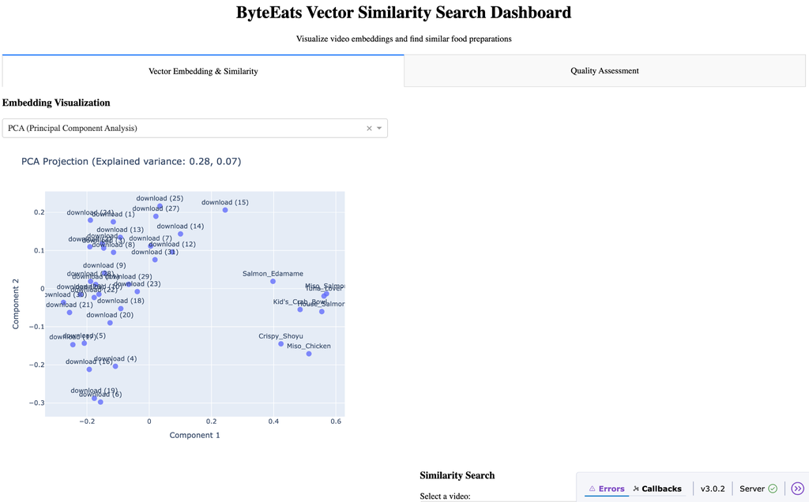
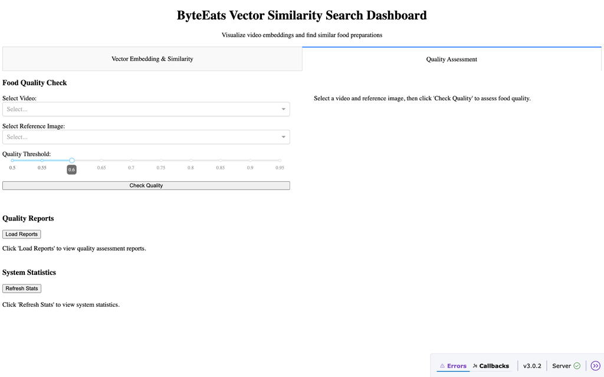
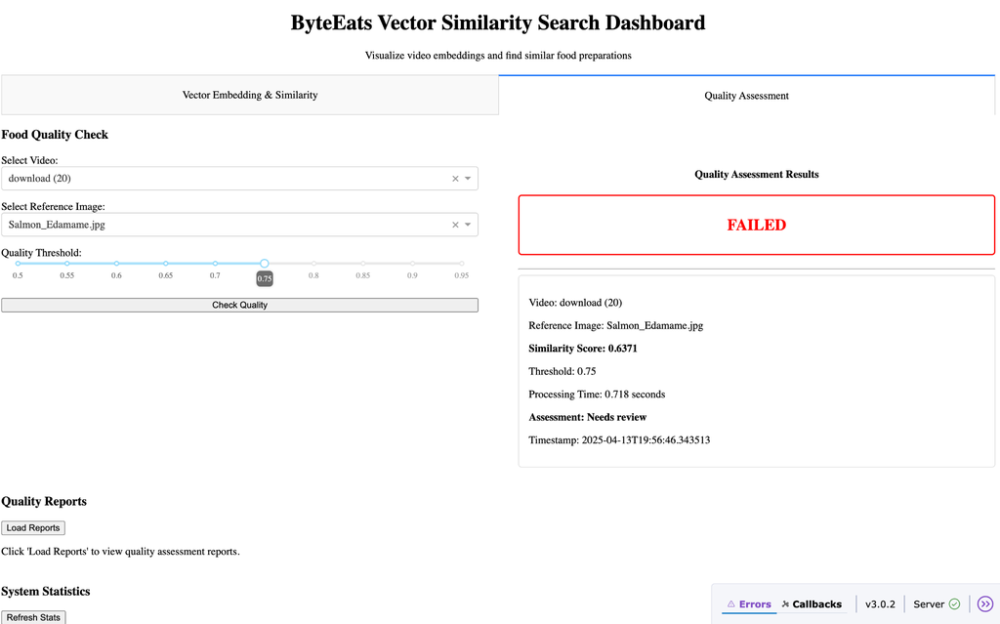
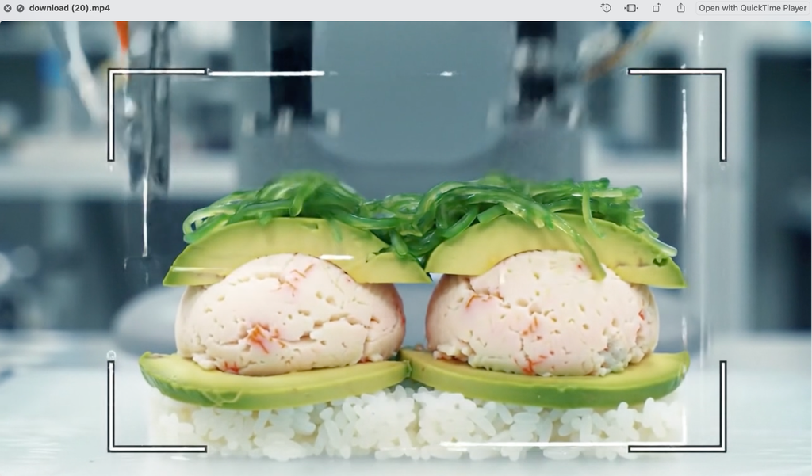
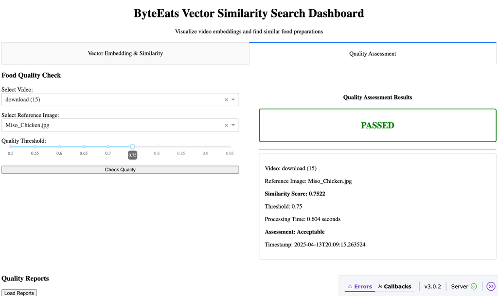
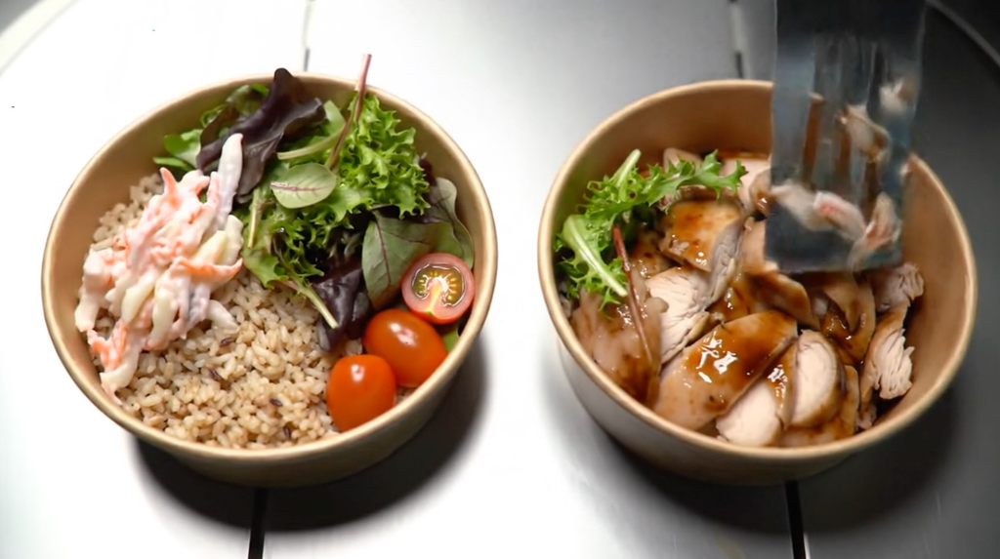
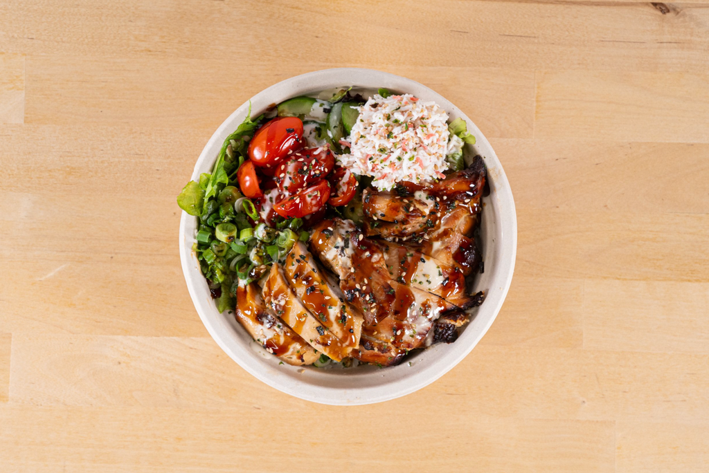
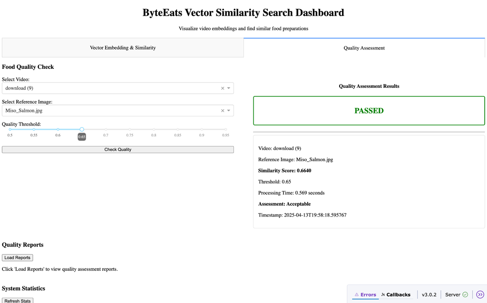
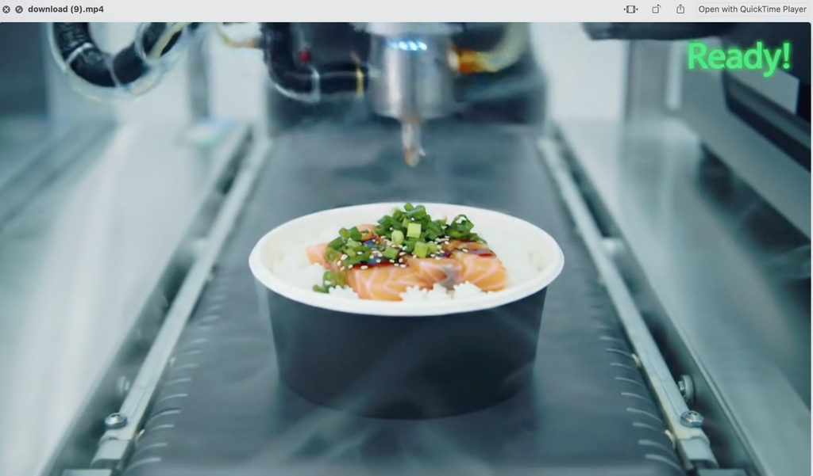
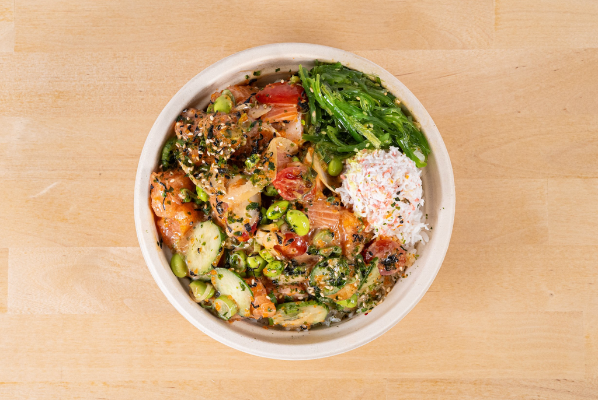

# Bonus: Scaling Similarity Search

Now that we have walked through an end-to-end scenario for ELT, let's look at one aspect of this in scale.

We will examine **Vector Similarity Search** where you take raw, high-volume video data and convert it into structured, indexable, AI-ready embeddings. The ByteEatsVectorSimilaritySearch system executed in this project represents a sophisticated approach to analyzing food preparation videos through vector embeddings. The goal is to compare prepared food videos against reference images for quality assurance.

Truly, at the end of the ELT for multimodal AI chapter, the vector embedding pipeline is one of the most advanced and final transformation steps.

You can do this in the safe environment of the playbook, learn what is happening in each step and then scale it across 1000s of videos and images.

## Architecture

The architecture comprises four key components:

- **Embedding Generator**: Converts videos and images into mathematical vectors using deep learning
- **Similarity Search Engine**: Finds similar items in vector space using FAISS
- **Quality Check API**: Compares prepared food against reference images
- **API Server & Dashboard**: Provides access and visualization

Here's where each of these components is:

| Component | Location | Description |
|---|---|---|
| Embedding Generator | `src/embeddings/generator.py` | Converts videos and images into mathematical vectors using deep learning with ResNet |
| Similarity Search Engine | `src/similarity/search.py` | Implements vector similarity search using FAISS |
| Quality Check API | `src/api/quality_check_api.py`, `src/utils/quality_checker.py` | API endpoints and core functionality for comparing images |
| API Server | `src/api/main.py` | FastAPI-based REST API |
| Dashboard | `src/api/dashboard.py` | Interactive visualization dashboard |

This architecture represents the evolution of data engineering beyond traditional ETL pipelines into AI-enhanced data transformation workflows. Data engineers who understand these patterns can bridge the gap between raw data and AI-ready information systems. It demonstrates a modern ETL/ELT pipeline that transforms fundamentally unstructured data (videos) into structured, indexable vectors.

This transformation enables:

- **Searchability**: Unstructured videos become mathematically comparable
- **Indexability**: Using FAISS, these high-dimensional vectors can be efficiently indexed and queried
- **Feature extraction**: Deep features are automatically extracted without manual annotation

---

## Step 1: Running the Embedding Generation

You can run the generator code with multiple input directories by specifying them as a comma-separated list:

```bash
cd /path/to/ByteEatsVectorSimilaritySearch
python src/embeddings/generator.py --input data/videos,data/images --output data/embeddings
```

The `generator.py` file uses a single unified architecture (`MediaEmbeddingGenerator` class) to process both videos and images, generating standardized 512-dimensional vector embeddings for each.

**For videos**, the generator extracts frames at regular intervals (every 5th frame by default), processes each frame through a ResNet neural network, and creates a single consolidated vector through temporal averaging of the frame embeddings.

**For reference images**, the generator processes each image directly through the same ResNet neural network architecture, ensuring embedding compatibility between videos and images.

**Standardized Output**: All embeddings (video or image) are normalized and saved as `.npy` files with corresponding metadata JSON files that include source information, processing time, and technical details.

### Expected Output

```
Using device: cpu
[Some deprecation warnings...]

Processing directory: data/videos
In directory data/videos:
  Found 32 video files and 0 image files
Processing 32 videos...
100%|████████████████████████████████████| 32/32 [00:45<00:00, 1.42s/it]

Processing directory: data/images
In directory data/images:
  Found 0 video files and 7 image files
Processing 7 images...
100%|████████████████████████████████████| 7/7 [00:00<00:00, 14.8it/s]

Summary:
  Processed 32 videos and 7 images
  Total processing time: 47.2 seconds
  Average processing time: 1.21 seconds per file
  Embeddings saved to data/embeddings
```

### Why This Approach?

- **Transfer learning**: We use ResNet-18, pretrained on ImageNet, removing the classification layer to extract 512-dimensional feature vectors.
- **Temporal averaging**: Rather than using complex recurrent networks, we average frame embeddings — a simple but effective approach for short food preparation videos.
- **L2 normalization**: Normalizing vectors simplifies similarity computation (cosine similarity).

### What Happens Behind the Scenes?

The ResNet architecture employs residual connections that allow training of very deep networks by addressing the vanishing gradient problem. By removing the classification layer, we access the 512-dimensional feature representation that encodes high-level visual patterns. This approach is known as "transfer learning" — repurposing a model trained on ImageNet for our specific domain.

In totality, this script:

- Loads a pre-trained ResNet model with the classification head removed
- Extracts frames from videos at regular intervals, aggregates frame features into a single video embedding, and processes each image directly through the same ResNet neural network architecture, ensuring embedding compatibility between videos and images
- Normalizes embeddings to ensure consistent similarity calculations
- Saves embeddings as NumPy arrays with detailed metadata

This stage exemplifies the transformation from unstructured data (videos and images) to structured data (fixed-dimension vectors), the cornerstone of modern ELT (Extract, Load, Transform) pipelines.

### Production Considerations

- **Scaling**: Processing thousands of videos and images requires distributed computation, possibly using Apache Spark with GPU acceleration
- **Versioning**: Embedding models evolve; we track version metadata to enable reprocessing
- **Cost-Benefit Analysis**: Computing embeddings is resource-intensive, so we must balance frequency against computational costs

Embedding generation is the core of the ETL process — transforming unstructured data into structured vector data that mathematical operations can be performed on. This transformation represents the shift from traditional data processing to AI-ready data.

---

## Step 2: Analyzing the Embeddings

```bash
cd /path/to/ByteEatsVectorSimilaritySearch
python analyze_embeddings.py
```

### Expected Output

The script will report how many video and image embeddings were found and verify that video and image embeddings have compatible shapes:

```
Found 32 video embeddings and 7 image embeddings
Video embedding shape: (512,)
Image embedding shape: (512,)
✓ Embeddings have compatible shapes
```

For each reference image, the script will show the 3 most similar videos with their similarity scores:

```
Top video matches for each reference image:

Tuna_Lover:
  1. download (15): 0.7764
  2. download (12): 0.7535
  3. download (14): 0.7260

Miso_Salmon:
  1. download (15): 0.7983
  2. download (12): 0.7648
  3. download (25): 0.7515

[additional image matches will be listed...]
```

And it will provide summary statistics about the embeddings:

```
Embedding statistics:
  Average video embedding magnitude: 0.8971
  Average image embedding magnitude: 0.9361
  Similarity between average video and image embedding: 0.7708
```

This analysis helps you understand if all embeddings were generated correctly and which videos are most similar to each reference image. You will also get the overall compatibility between video and image embeddings and the quality and consistency of the generated embeddings.

Higher similarity scores (closer to 1.0) indicate stronger matches between videos and images.

---

## Step 3: Running the Similarity Search Engine

The Similarity Search Engine is located in `src/similarity/search.py` and uses FAISS for vector similarity search.

While you can interact with this engine through the API or test script, you can also use it directly:

```python
from src.similarity.search import SimilaritySearch

# Initialize with embedding directory
search = SimilaritySearch("data/embeddings")

# Load embeddings
num_loaded = search.load_embeddings()
print(f"Loaded {num_loaded} embeddings")

# Build search index
search.build_index(index_type="Flat")  # Options: "Flat", "IVF", "HNSW"

# Find similar items to an existing one
results, stats = search.find_similar_by_id("Tuna_Lover", k=5)

# Print results
for result in results:
    print(f"{result['rank']}. {result['video_id']}: {result['similarity_score']:.4f}")
```

`search.py` provides several important features for the ByteEats system:

| Feature | Description |
|---|---|
| **Performance** | Uses optimized FAISS algorithms that can search thousands of vectors in milliseconds |
| **Flexibility** | Supports different index types for speed/accuracy trade-offs |
| **Cross-Modal Search** | Works with both video and image embeddings in the same index |
| **Rich Metadata** | Returns comprehensive information about similar items |

### What `search.py` Does

This file provides:

- **Embedding Management**: Methods to load and organize embeddings from `.npy` files
- **FAISS Index Building**: Creates specialized indexes for efficient similarity search:
  - **Flat index** (exact search)
  - **IVF index** (inverted file, faster but approximate)
  - **HNSW index** (hierarchical navigable small world graphs)
- **Similarity Search Methods**:
  - `find_similar()`: Find similar items given a vector
  - `find_similar_by_id()`: Find similar items to an existing item
  - `batch_search()`: Process multiple search queries
- **Analysis Tools**: Methods to analyze embedding clusters and find patterns

### Starting the Similarity Search API

```
Starting the similarity search API on port 8085...
[Some deprecation warnings about FastAPI on_event]
Starting ByteEats Vector Similarity Search API on port 8085
Loading 39 embeddings...
Loaded 39 embeddings with shape (39, 512)
Built Flat index with 39 vectors in 0.000 seconds
Using device: cpu
[Some deprecation warnings about torchvision models]
API initialized with 39 embeddings
INFO:     Started server process [43267]
INFO:     Waiting for application startup.
INFO:     Application startup complete.
INFO:     Uvicorn running on http://0.0.0.0:8085 (Press CTRL+C to quit)
```

As API requests come in, you'll see log lines like:

```
INFO:     127.0.0.1:60663 - "GET /api/videos HTTP/1.1" 200 OK
INFO:     127.0.0.1:60664 - "GET /api/similar/download%20%2828%29 HTTP/1.1" 200 OK
```

### Running the Test Script

When you run `python test_similarity_search.py`, you'll see:

```
Testing ByteEats Vector Similarity Search Engine
==================================================

Loading 39 embeddings...
Loaded 39 embeddings with shape (39, 512)
Built Flat index with 39 vectors in 0.000 seconds

Finding videos similar to download (28):
  1. download (28): 1.0000
  2. download: 0.7820
  3. download (10): 0.7793
  4. download (11): 0.7716
  5. download (9): 0.7540
Search completed in 3.644 ms

Finding videos similar to image Tuna_Lover:
  1. Tuna_Lover: 1.0000
  2. Miso_Salmon: 0.8830
  3. House_Salmon: 0.8573

Finding videos similar to image Miso_Salmon:
  1. Miso_Salmon: 1.0000
  2. Tuna_Lover: 0.8830
  3. House_Salmon: 0.8651

[More similar results for other images...]

Custom query using Tuna_Lover embedding:
  1. Tuna_Lover: 0.6120
  2. Miso_Salmon: 0.5774
  3. House_Salmon: 0.5597
  4. Miso_Chicken: 0.5564
  5. Crispy_Shoyu: 0.5498
Search completed in 0.013 ms

All tests completed successfully!
```

### What the Similarity Search Engine Does

- It loads embeddings (512-dimensional vectors) for both videos and images
- It creates a FAISS index for fast similarity search
- It can find similar items based on cosine similarity between embeddings
- It returns ranked results with similarity scores (higher is better)

The system works with both embeddings from videos and reference images, allowing for powerful cross-modal similarity search capabilities.

> **Key Learning for Data Engineers**: Vector similarity enables a fundamental shift in data retrieval — from explicit queries ("find videos with salmon") to similarity-based queries ("find videos similar to this one"). This unlocks new applications not possible with traditional databases.

---

## Step 4: Testing the Quality Check API

```bash
cd /path/to/ByteEatsVectorSimilaritySearch
export API_PORT=8085
export IMAGE_DIR=data/images
bash run_pipeline.sh --start-api
```

You can then run the Quality Check Tool in a new terminal window:

```bash
cd /path/to/ByteEatsVectorSimilaritySearch
export API_PORT=8085
export IMAGE_DIR=data/images
bash run_pipeline.sh --quality-check
```

You'll enter an interactive session where you can:

- Select from available videos (numbered list)
- Choose a reference image to compare against (numbered list)
- Set a quality threshold (between 0.5–0.95)

The system will process your request and display:

- A quality assessment showing **PASSED** or **FAILED**
- Similarity score between the video and reference image
- Whether the video meets your quality threshold
- Processing time information

You'll also see a summary table of all quality reports.

### What to Expect

- Similarity scores typically range from ~0.6 to ~0.85
- Higher thresholds (>0.8) may result in more "FAILED" assessments
- The system is comparing visual features using an AI model
- Processing time varies depending on video length

The quality check helps you ensure food preparation videos match their reference images, which is essential for maintaining consistent food quality standards for ByteEats!

### Sample Interaction

```
Running the quality check tool...
Using API URL: http://localhost:8085

=== ByteEats Quality Check Tool ===

Found 32 videos:
  1. download (28)
  2. download (20)
  3. download (27)
  ...
  32. download (6)

Found 7 reference images:
  1. Crispy_Shoyu.jpg
  2. Tuna_Lover.jpg
  3. Salmon_Edamame.jpg
  4. Miso_Chicken.jpg
  5. Kid's_Crab_Bowl.jpg
  6. Miso_Salmon.jpg
  7. House_Salmon.jpg

Select a video to check (enter number):
> 10

Select a reference image (enter number):
> 3

Enter quality threshold (0.5-0.95, default 0.75):
> 0.80

Checking quality of download (25) against Salmon_Edamame.jpg...

==================================================
QUALITY CHECK: FAILED
==================================================
Video: download (25)
Reference Image: Salmon_Edamame.jpg
Similarity Score: 0.7753 (threshold: 0.80)
Assessment: Needs review
Processing Time: 0.726 seconds
==================================================

Would you like to see all quality reports? (y/n)
> y

Found 1 quality reports:
VIDEO           REFERENCE            SCORE   THRESHOLD  RESULT
---------------------------------------------------------------------------
download (25)   Salmon_Edamame.jpg   0.7753  0.80       FAILED
```

---

## Step 5: Running the API Server & Dashboard

To run the API server:

```bash
cd /path/to/ByteEatsVectorSimilaritySearch
export API_PORT=8085
export IMAGE_DIR=data/images
bash run_pipeline.sh --start-api
```

You'll see:

```
Starting ByteEats Vector Similarity Search Dashboard on port 8095
Dash is running on http://0.0.0.0:8095/
```

To access the dashboard, open your web browser and navigate to: **http://localhost:8095/**

### Tab 1: Vector Embedding Visualization

In the first tab, you see a vector embedding and similarity dashboard.

The screenshot below shows a Vector Embedding visualization using PCA (Principal Component Analysis). This 2D plot shows how videos and reference images relate to each other in embedding space. You can see the video files (labeled as "download (X)") clustered on the left side, while reference images (like Salmon_Edamame, Miso_Salmon, etc.) appear on the right. This suggests the embedding model effectively distinguishes between videos and reference images.



### Tab 2: Quality Assessment

The second tab is the Quality Assessment tab, showing the interface with dropdown menus for selecting videos and reference images, plus a quality threshold slider set to 0.6.



Now, let's have some fun! Select a video and a reference image, set a quality threshold, and test if it passes or fails.

---

### Example: Quality Check FAILED

If you want to relate to the screenshot below, watch Video 20 — it's clearly not a salmon edamame bowl. In fact, it's not even close to being the Kid's Crab Bowl. Go ahead, select the Kid's Crab Bowl and check if it passes (well, maybe at a low threshold!).

As you can see from the screenshot, the quality check **FAILED**. The user compared "download (20)" against "Salmon_Edamame.jpg" with a threshold of 0.75. The similarity score was only 0.6371, which is below the threshold, resulting in a "Needs review" assessment.



*Video frame from download(20) on the left, prepared food reference image of Salmon_Edamame.jpg on the right:*

| Video Frame | Reference Image |
|---|---|
|  |  |

---

### Example: Quality Check PASSED (Miso Chicken)

As you can see from the screenshot, the quality check **PASSED**. The user compared "download (15)" against "Miso_Chicken.jpg" with a threshold of 0.75. The similarity score was 0.7522, exceeding the threshold, resulting in an "Acceptable" assessment.



*Video frame from download(15) on the left, prepared food of a Miso_Chicken.jpg reference image on the right:*

| Video Frame | Reference Image |
|---|---|
|  |  |

This one is way too close and passes the quality check at a 0.75 threshold, but any more than that, it fails! Well, our ByteEats robot chef didn't assemble it all in one bowl.

---

### Example: Quality Check PASSED (Miso Salmon)

Now let's say I reduced the threshold and compared video 9, where there's a passable version of the miso salmon bowl being prepared by the robot — it actually passes the quality check!

As you can see from the screenshot, the quality check **PASSED**. The user compared "download (9)" against "Miso_Salmon.jpg" with a lower threshold of 0.65. The similarity score was 0.6640, exceeding the threshold, resulting in an "Acceptable" assessment.



*Video frame from download(9) on the left, prepared food of a Miso_Salmon.jpg reference image on the right:*

| Video Frame | Reference Image |
|---|---|
|  |  |

Alright, the Quality Control Team at ByteEats may get you to be more stringent here. Let's look at one more example.

---

## Improving Matching Quality

But jokes apart, let's talk about improving matching quality in a visual similarity system like ByteEats Core Operations Pipeline.

Now, your first instinct might be to tweak the thresholds or retrain the model — but let's approach this systematically.

### Fine-Tuning the Embedding Model

Right now, we're using ResNet. That's fine for proof of concept. But it doesn't contain 10,000 variations of salmon bowls under industrial lighting. It contains wolves, airplanes, and strawberries. So your model is learning "what a thing looks like" in general — and not what distinguishes a good salmon poke bowl from a mediocre one.

To fix this, **fine-tune**. Gather a domain-specific dataset — in this case, food preparation imagery from the ByteEats repository — and re-train the embedding layers on contrastive or triplet loss. Even a few thousand annotated examples will yield measurable gains. Your model starts learning that the brightness of salmon, the sheen of seaweed, or the consistency of a rice mound actually matter.

### Augmenting Embeddings with Domain-Aware Features

You can augment the embeddings with engineered features that are domain-aware. Extract color histograms tuned to food palettes, or use classical texture descriptors — maybe Gabor filters or local binary patterns — to capture crispness or freshness visually. You could even build small ingredient detectors (a lightweight YOLOv8 or MobileNet) that confirm whether salmon, edamame, or tobiko are present.

### Dynamic Thresholds

You cannot have one threshold across all dishes. A salad and a seared tuna bowl have very different visual tolerances. Instead, implement **dynamic thresholds** — use historical QA pass rates to compute statistical cutoffs per category. For salmon, maybe require a similarity of 0.78; for crab bowls, maybe 0.65 is sufficient. Let the data dictate the tolerance.

### Multi-Anchor Reference Images

We're using one image per test. That's brittle. For a production pipeline, you would capture at least 5 to 10 images per bowl under production lighting, from different angles, with slightly varied presentations. You would use these as anchors for matching. Better still, you could generate synthetic augmentations using style-preserving GANs or contrastive image editing to create robust, controlled variability.

### Weighted Similarity

This is subtle but powerful — use **weighted similarity**. Not all pixels are equal. You can apply a region-weighted similarity model that gives higher attention to key ingredients — for example, the protein area — and downweights distractions like garnish spillover or container edges. It's not about what's in the photo, it's about where it is in the photo.

### Semantic Validation

A visual match alone isn't enough — you can run an ingredient detection model in parallel. Make sure the detected ingredients match the order metadata. A bowl may look similar but contain the wrong protein — and that's a QA failure.

### Explainability

For the human-in-the-loop systems you'll build, give visual feedback. Show heatmaps of the regions that contributed most to the match. Let operators see *why* something was accepted or flagged. This builds trust and enables debugging.

> In short, you're not just improving image matching. You're teaching your system to see food the way a chef or quality control specialist does — through structure, context, and intent. And that is where data engineering meets perceptual intelligence.

---

## Scaling to Production

I know what you're thinking — our code repo works for 32 videos and 7 images, but how can you scale this for 100,000+ videos of meals being prepared and hundreds of high-resolution images of finished bowls generated by ByteEats daily?

Let's walk through what it really takes to scale this pipeline from a clean demo into a production-grade backbone for AI operations.

### Infrastructure Evolution

You're no longer working with a single-threaded Python script or a tidy FastAPI endpoint. For embedding generation alone, we're now dealing with distributed computation. In a production environment, you'd deploy a **Spark or Dask cluster** — something with enough muscle to parallelize frame extraction, run batched ResNet inference, and store intermediate results with fault tolerance. We're talking about 20 to 50 high-memory compute nodes, each handling a shard of the video corpus. That's the kind of architecture you need to stay ahead of a 100K-video backlog.

### Vector Database

Our little FAISS-based index in-memory? That simply won't do at this scale. We'll need to transition to dedicated vector databases such as **Pinecone, Milvus, or Qdrant**. These systems implement optimized approximate nearest neighbor (ANN) search algorithms, ensuring we get response times in the 50–100 millisecond range even as we approach a million vectors. This is about building real-time feedback loops, anomaly detection, and quality tracking — without bottlenecks.

### Storage Calculations

You must be precise in your calculations. If you're working with half a petabyte of raw video data — let's say 500MB per video, times 1 million — that's 500TB right there. Embeddings? They're small, yes — just over 2GB for a million 512-dimensional float32 vectors — but reference images and QA reports will start to add up, maybe another 50GB and 5GB respectively. All of this must be stored, versioned, and made available across nodes.

### Microservices Architecture

What was once a sequential process must now become a constellation of decoupled microservices. Quality inspection, similarity search, feature extraction — they all need to run independently, communicating over a robust message bus. Think **Kafka or RabbitMQ**. More importantly, each component must be idempotent, so that retries in a distributed system don't accidentally double-count or corrupt data. These aren't just engineering patterns — they're survival mechanisms at scale.

### Incremental Processing

You do not want to reprocess all videos every time your reference set changes. You'll need to implement intelligent change detection — likely via content hashing or perceptual fingerprinting — and ensure you're only extracting and analyzing what's truly new. That's how production systems breathe efficiently — by processing deltas, not mountains.

### API Layer Improvements

You'll want to adopt an **API gateway pattern** with intelligent caching — Redis or Memcached will do. Separate read and write flows, enforce rate limits, and queue requests gracefully to avoid a thundering herd problem. Trust me, if your similarity endpoint becomes popular, it will get hammered.

### Performance Tuning

Your embeddings can be pre-computed and stored, rather than generated on demand. **Model quantization** (FP16, INT8) can drastically reduce inference costs and latency. And if you're really aggressive, you could distill your ResNet into a smaller architecture — maybe MobileNet or EfficientNet — for 3x to 5x speedups with minimal performance loss.

### Efficient Video Processing

You'll want to avoid the naive "process all frames" approach. Use **adaptive sampling** — perhaps a shot-boundary detector or entropy-based frame selector — to extract only the most informative frames. You can run this across a GPU cluster, if you're lucky enough to have one.

### Multi-Stage Retrieval

Implement a **multi-stage retrieval strategy**. Filter candidates first with metadata — prep type, ingredient tags, order time — before engaging the expensive vector search. This pruning can reduce search space dramatically. And within the vector layer, use hierarchical indexing or graph-based methods to make search times sub-linear.
